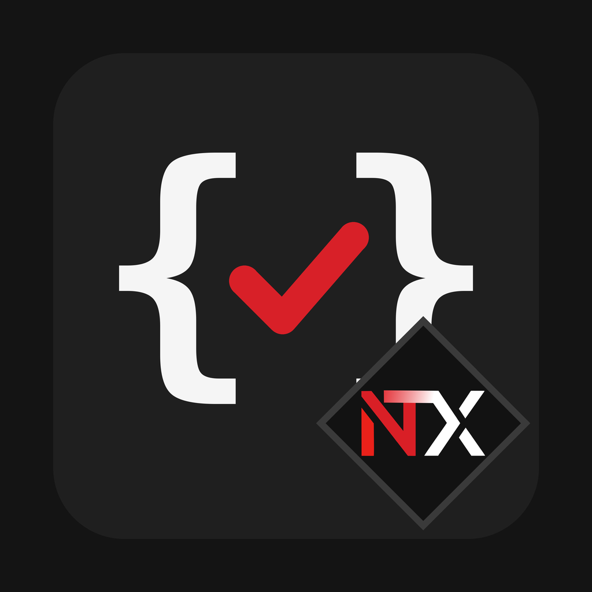

<p align="center">
  
</p>

<h1 align="center">Frappe Code Standards <sup>beta</sup></h1>

<p align="center">
  Make Claude write Frappe and ERPNext code the way an experienced Frappe developer would —<br>
  in the right file, with the framework's own APIs, and easy for the next developer to read.
</p>

<p align="center">
  
  <a href="LICENSE"></a>
  
  
</p>

---

> [!NOTE]
> **This plugin is in beta.** It will keep maturing as more people use it on real projects, and
> Claude can still make mistakes with it switched on, so review the output the way you would review
> a teammate's code. If something slips through, please [open an issue](../../issues/new/choose).
> Thank you for the support.

## Why this exists

AI assistants can write Frappe code that *works* but doesn't *belong*. The usual problems:

- Form logic for your own DocType dumped into `hooks.py` + `public/js` instead of the DocType's own `.js` file
- `raise Exception(...)` or silent returns instead of `frappe.throw(_("..."))`
- Untranslated user-facing strings
- `set_query` written in `refresh`, or replaced with hand-rolled filtering
- Validation done only in JavaScript
- Database calls inside loops, `fields=["*"]`, raw SQL built with f-strings

The code runs, but it's not where anyone on the team would look for it, and it fights the framework
instead of using it. This plugin gives Claude a clear set of standards so the output looks like it
was written by someone who has shipped Frappe apps before.

## Before and after

You ask: *"On Loan Application, only show active loan types for the selected company, and stop the
user if To Date is before From Date."*

**Without the plugin**

```python
# hooks.py
doctype_js = {"Loan Application": "public/js/loan_application.js"}   # our own DocType!
```

```python
# loan_application.py
def validate(self):
    if self.to_date < self.from_date:
        raise Exception("Invalid dates")
```

**With the plugin**

```js
// my_app/lending/doctype/loan_application/loan_application.js
frappe.ui.form.on("Loan Application", {
    setup(frm) {
        frm.set_query("loan_type", () => ({
            filters: { company: frm.doc.company, disabled: 0 },
        }));
    },
});
```

```python
# my_app/lending/doctype/loan_application/loan_application.py
def validate(self):
    self.validate_dates()

def validate_dates(self):
    if self.to_date and getdate(self.to_date) < getdate(self.from_date):
        frappe.throw(_("To Date cannot be before From Date"))
```

## What it enforces

- **Code placement** — your DocTypes keep logic in their own files; other apps are extended through hooks, never edited
- **Errors and messages** — `frappe.throw`, `frappe.msgprint` and the Error Log, used the way the framework intends
- **Translations** — every user-facing string wrapped for translation
- **Form scripts** — `set_query` in `setup`, form API for buttons and server calls
- **Data access** — explicit fields, no queries in loops, Query Builder over raw SQL
- **Security** — permission checks in whitelisted methods, parameterised queries
- **Review** — a checklist before finishing, plus the `bench` commands to run

The full rules live in [`SKILL.md`](plugins/frappe-code-standards/skills/frappe-code-standards/SKILL.md),
with detailed patterns in the [`references/`](plugins/frappe-code-standards/skills/frappe-code-standards/references) folder.

## Installation

### Claude Code

```bash
claude plugin marketplace add NexTash/Frappe-Code-Standards
claude plugin install frappe-code-standards@nextash
```

To keep it up to date automatically, open `/plugin` in Claude Code → **Marketplaces** → `nextash`
→ **Enable auto-update**.

Turn it off for non-Frappe work, and back on later:

```bash
claude plugin disable frappe-code-standards@nextash
claude plugin enable frappe-code-standards@nextash
```

### claude.ai

Zip the skill folder and upload it under **Skills** in your claude.ai settings:

```bash
cd plugins/frappe-code-standards/skills
zip -r frappe-code-standards.zip frappe-code-standards
```

## Using it in a project

Copy [`templates/CLAUDE.md`](templates/CLAUDE.md) into the root of your Frappe project and fill in
the project facts: Frappe version, which apps are yours, your site name and the prefix you use for
custom fields. Claude reads this file at the start of every session, which tells it which DocTypes
it can edit directly and which ones must be extended through hooks.

Spot a mistake Claude keeps making in that one project? Add a line under **Project-specific rules**.

## What's inside

```
plugins/frappe-code-standards/
└── skills/frappe-code-standards/
    ├── SKILL.md                         Core rules, loaded when you work on Frappe code
    └── references/
        ├── code-placement.md            Where every kind of code belongs
        ├── server-patterns.md           Controllers, whitelisted methods, errors, DB access
        ├── client-patterns.md           Form scripts, set_query, dialogs, child tables
        ├── hooks-and-customization.md   hooks.py, doc_events, fixtures, patches
        ├── performance.md               Queries, caching, background jobs
        ├── reports-and-printing.md      Script and query reports, print formats
        └── review-checklist.md          What Claude checks before finishing a task
```

The plugin is plain Markdown. It runs no scripts, makes no network calls and collects no data.

## Contributing

Found a pattern Claude still gets wrong, or a rule that doesn't match how the Frappe community
works? [Open an issue](../../issues/new/choose) using the bug report or feature request template,
with a short example of the bad output and what it should have been. Pull requests against the
files in `references/` are welcome too. Rules should be concrete, show a right and wrong
example where it helps, and follow the official
[Frappe documentation](https://docs.frappe.io/framework).

When changing the plugin, bump `version` in
[`plugin.json`](plugins/frappe-code-standards/.claude-plugin/plugin.json) so installed copies pick up
the update.

## Support

No paywall, no tip jar, no fine print. Just cleaner Frappe code. If it earned its place in your
workflow, a [star](https://github.com/NexTash/Frappe-Code-Standards) is the most eloquent thanks
you can offer. The coffee's on us. The star's on you.

## License

[MIT](LICENSE) © NexTash

<p align="center">
  <i>"Any fool can write code that a computer can understand. Good programmers write code that humans can understand."</i><br>
  — Martin Fowler<br><br>
  <sub>Crafted with curiosity and passion by <a href="https://github.com/faisal-zahoor">Faisal Zahoor</a> · <a href="https://github.com/NexTash">NexTash</a></sub>
</p>
